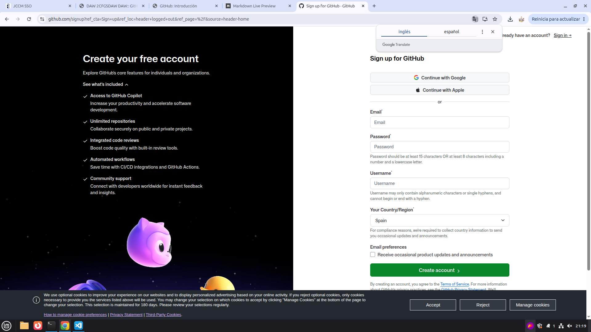

# GitHub + Markdown  
## Álvaro Rodrigo Morales

GitHub es un sistema de guardado en la nube disponible para que los desarrolladores puedan colaborar en proyectos de código abierto y crear sus propios repositorios. Además, se puede conectar con Git en local para tener un control de versiones más preciso.  

En este documento, veremos cómo crearnos una cuenta, crear un repositorio y añadir un archivo a nuestro repositorio.

## 1. Crear una cuenta de GitHub
Para crear una cuenta pinchamos en el siguiente botón de la página principal:

A continuación rellenaremos el siguiente formulario:

Tras crear una cuenta apareceremos en el siguiente menú:

## 2. Hacer un repositorio de GitHub  
A continuación vamos a crear un nuevo repositorio, para ello seleccionaremos nuestra foto de perfil y seleccionaremos la opción "repositories", tras ello nos saldrá el siguiente menú, en el cual pulsaremos el botón "new" de color verde que se indica.

Tras esto nos aparecerá un formulario con diversas opciones, de todas estas opciones la única obligatoria es ponerle nombre al repositorio, aunque personalmente recomiendo activar la opción de añadir el archivo README y darle una descripción al repositorio.  

## 3. Añadir archivos a un repositorio

A continuación vamos a ver cómo añadir un nuevo archivo a nuestro repositorio, para ello, vamos a seleccionar la opción add files, en concreto usaremos upload files como se muestra en la imagen.

Tras pinchar en esta opción, se abrirá una ventana en la que podremos arrastrar archivos para subirlos.  
De manera alternativa podemos utilizar GIT para subir archivos a GitHub.  
## 4. Conclusión  

En conclusión, GitHub es un excelente sistema de guardado en la nube para llevar un buen seguimiento de nuestro proyecto y poder bajarlo rápidamente en nuevos equipos.
