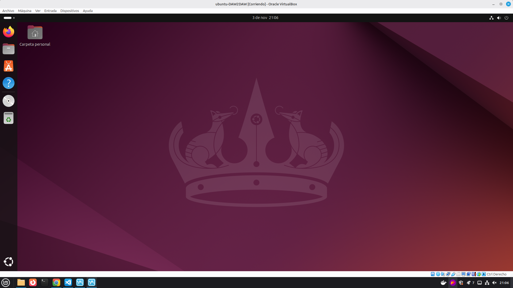
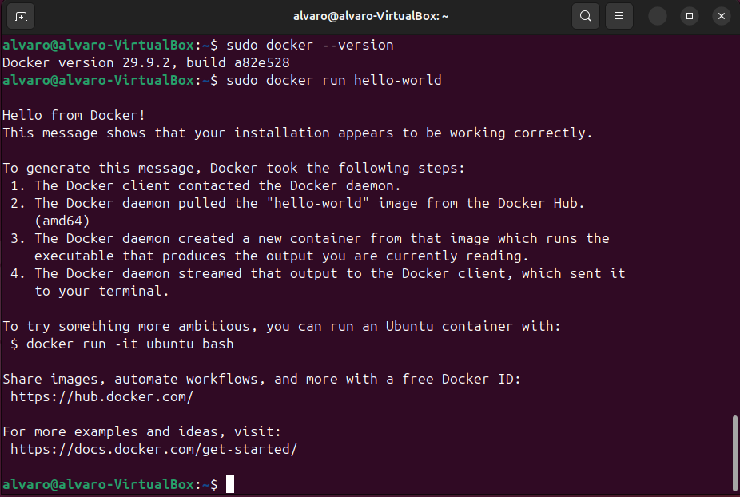
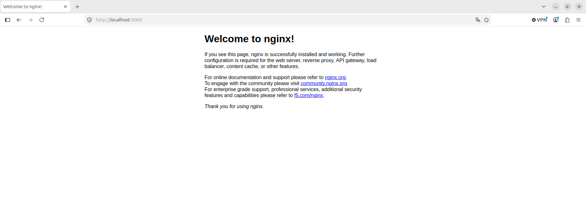
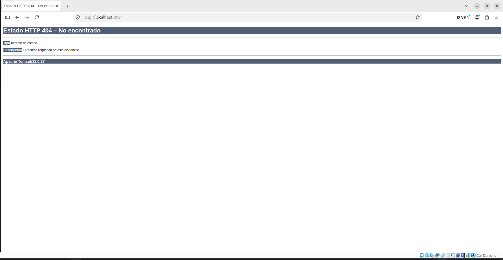

# Iniciación a la Virtualización: Ubuntu y Docker

**Módulo:** Despliegue de Aplicaciones Web · 2º DAW
**Fecha:** 3 de noviembre de 2026

---

## Índice

1. [Introducción](#1-introducción)
2. [Instalación de Ubuntu en VirtualBox](#2-instalación-de-ubuntu-en-virtualbox)
3. [Instalación de Docker](#3-instalación-de-docker)
4. [Contenedores de servidor web y de aplicaciones](#4-contenedores-de-servidor-web-y-de-aplicaciones)
5. [Requerimientos para implantar una aplicación web](#5-requerimientos-para-implantar-una-aplicación-web)
6. [Conclusiones](#6-conclusiones)

---

## 1. Introducción

### 1.1 ¿Qué es la virtualización?

La virtualización es una tecnología que permite ejecutar varios sistemas operativos o entornos de software independientes sobre una misma máquina física, mediante un **hipervisor** (VirtualBox, VMware, Hyper-V, etc.). Cada entorno virtual recibe el nombre de **máquina virtual (VM)**.

Conceptos clave:

- **Hipervisor:** software que crea y gestiona las máquinas virtuales.
- **Imagen ISO:** archivo que contiene una copia exacta de un sistema operativo o de un software de instalación.
- **Recursos virtualizados:** CPU, memoria RAM, almacenamiento y red.

### 1.2 ¿Qué es un contenedor?

Un contenedor es una unidad de software que empaqueta el código, las dependencias y la configuración necesarias para ejecutar una aplicación. A diferencia de una máquina virtual, los contenedores comparten el kernel del sistema operativo anfitrión, por lo que son más ligeros y arrancan mucho más rápido.

Ventajas de Docker:

- **Portabilidad:** la misma imagen funciona en cualquier equipo con Docker.
- **Aislamiento:** cada contenedor es independiente del resto.
- **Escalabilidad:** es sencillo lanzar varias instancias.
- **Rapidez de despliegue:** un servicio se levanta en segundos.

### 1.3 Objetivo de la práctica

Montar un entorno de pruebas completo: una máquina virtual con Ubuntu, Docker instalado sobre ella y dos contenedores (un servidor web **Nginx** y un servidor de aplicaciones **Apache Tomcat**), comprobando su funcionamiento desde el navegador.

---

## 2. Instalación de Ubuntu en VirtualBox

### 2.1 Pasos seguidos

1. Descargar la ISO de **Ubuntu 24.04 LTS** desde la página oficial de Ubuntu.
2. Abrir VirtualBox y crear una nueva máquina virtual con las siguientes características:

| Parámetro | Valor |
|---|---|
| Nombre | Ubuntu-DAW2DAW |
| Memoria RAM | 8096 MB |
| Disco duro virtual | Mínimo 50 GB |
| Tipo de red | NAT |

3. Seleccionar la ISO descargada como medio de instalación, arrancar la máquina y completar el asistente de instalación de Ubuntu.
4. Instalar las Guest Additions para mejorar la integración con el equipo anfitrión (resolución de pantalla, portapapeles compartido, etc.).
5. Reiniciar la máquina y comprobar que el sistema arranca correctamente.

### 2.2 Resultado

Escritorio de Ubuntu funcionando dentro de VirtualBox una vez finalizada la instalación:



---

## 3. Instalación de Docker

### 3.1 Pasos seguidos

**1. Actualizar los repositorios y el sistema:**

```bash
sudo apt update && sudo apt upgrade -y
```

**2. Instalar las dependencias necesarias:**

```bash
sudo apt install ca-certificates curl gnupg -y
```

**3. Añadir el repositorio de Docker e instalar Docker:**

```bash
curl -fsSL https://get.docker.com | sudo sh

curl -R -O https://desktop.docker.com/linux/main/amd64/docker-desktop-amd64.deb

sudo apt-get update && sudo apt-get install ./docker-desktop-amd64.deb -y
```
**4. Verificar que Docker funciona correctamente:**

```bash
docker --version
docker run hello-world
```

### 3.2 Resultado

La primera orden muestra la versión instalada de Docker. La segunda descarga la imagen `hello-world` desde Docker Hub y crea un contenedor que imprime un mensaje de bienvenida. Este mensaje confirma que la instalación es correcta:



---

## 4. Contenedores de servidor web y de aplicaciones

### 4.1 Diferencia entre servidor web y servidor de aplicaciones

- **Servidor web:** atiende peticiones HTTP/HTTPS y sirve contenido (por ejemplo, Nginx o Apache HTTP Server).
- **Servidor de aplicaciones:** ejecuta la lógica de negocio de la aplicación (por ejemplo, Tomcat o WildFly).

### 4.2 Búsqueda de imágenes

Se consultan las imágenes disponibles en Docker Hub:

```bash
docker search nginx
docker search tomcat
```

### 4.3 Descarga y arranque de los contenedores

```bash
docker run -d -p 8080:80 --name webserver nginx
docker run -d -p 8081:8080 --name appserver tomcat
```

Explicación de las opciones utilizadas:

| Opción | Significado |
|---|---|
| `-d` | Ejecuta el contenedor en segundo plano (*detached*). |
| `-p 8080:80` | Redirige el puerto **8080** del equipo al puerto **80** del contenedor. |
| `--name` | Asigna un nombre al contenedor para identificarlo fácilmente. |
| `nginx` / `tomcat` | Imagen a partir de la cual se crea el contenedor. |

Si la imagen no existe en local, Docker la descarga automáticamente de Docker Hub.

### 4.4 Verificación de los contenedores activos

```bash
docker ps
```

Este comando lista los contenedores en ejecución, con su nombre, imagen y puertos publicados. Deben aparecer `webserver` y `appserver`.

### 4.5 Pruebas desde el navegador

#### Nginx: `http://localhost:8080`



Se muestra la página por defecto «Welcome to nginx!», lo que confirma que el servidor web está instalado y responde correctamente.

#### Tomcat: `http://localhost:8081`



Se muestra una página de **Estado HTTP 404 – No encontrado** con la versión *Apache Tomcat/11.0.27*. Esto **no es un fallo**: significa que Tomcat está en funcionamiento y respondiendo, pero la imagen oficial no incluye por defecto ninguna aplicación desplegada en la ruta raíz (`/`), por lo que no hay recurso que servir.

---

## 5. Requerimientos para implantar una aplicación web

### 5.1 Requisitos de hardware y software

**Hardware (orientativo para un entorno pequeño o de pruebas):**

| Recurso | Mínimo recomendado |
|---|---|
| CPU | 2 núcleos |
| RAM | 4 GB (más si se ejecutan servidor de aplicaciones y base de datos) |
| Almacenamiento | 50 GB, preferiblemente SSD |
| Red | Tarjeta de red con conectividad estable |

Estos valores crecen con el número de usuarios concurrentes y con la complejidad de la aplicación.

**Software:**

- Sistema operativo del servidor (por ejemplo, Ubuntu Server LTS).
- Servidor web (Nginx o Apache HTTP Server).
- Servidor de aplicaciones o entorno de ejecución (Tomcat, WildFly, Node.js, PHP-FPM, etc.).
- Sistema gestor de base de datos, si la aplicación lo necesita (MySQL, MariaDB, etc.).
- Tecnología de virtualización o contenedores (VirtualBox, Docker) para aislar y facilitar el despliegue.
- Herramientas de control de versiones y despliegue (Git).

### 5.2 Infraestructura de red

- **Direccionamiento IP:** el servidor necesita una IP fija (pública o privada, según el caso).
- **DNS:** un nombre de dominio que apunte al servidor.
- **Puertos abiertos:** 80 (HTTP) y 443 (HTTPS) hacia el exterior; el resto, cerrado salvo necesidad (por ejemplo, 22 para SSH, restringido por IP).
- **Cortafuegos:** reglas que limiten el tráfico entrante y saliente (por ejemplo, `ufw` o `iptables`).
- **Red de las máquinas virtuales:** en esta práctica se usa **NAT**; para exponer un servicio a otros equipos de la red sería necesario usar adaptador puente o reenvío de puertos.
- **Balanceadores y proxy inverso:** en entornos con más carga, un proxy inverso (como Nginx) reparte las peticiones entre varios servidores.

### 5.3 Configuración del servidor web y del servidor de aplicaciones

**Servidor web:**

- Definir la raíz de documentos y los sitios virtuales (*virtual hosts* o *server blocks*).
- Configurar los puertos de escucha y, si procede, la redirección de HTTP a HTTPS.
- Habilitar HTTPS con certificados SSL/TLS.
- Ajustar compresión, caché y registros (*logs*).
- Si hay servidor de aplicaciones, configurar el servidor web como **proxy inverso** hacia él.

**Servidor de aplicaciones:**

- Desplegar la aplicación empaquetada (por ejemplo, un `.war` en Tomcat).
- Configurar el puerto de escucha, el uso de memoria de la JVM y el número de hilos.
- Configurar las conexiones a la base de datos (*datasource*).
- Gestionar usuarios y roles de administración.

**Con contenedores (como en esta práctica):** la configuración se aplica mediante variables de entorno, volúmenes y ficheros montados, y se puede automatizar con **Docker Compose**.

### 5.4 Seguridad y mantenimiento

**Seguridad:**

- Mantener el sistema operativo, Docker y las imágenes actualizados.
- Usar HTTPS en todas las comunicaciones.
- Aplicar el principio de mínimo privilegio: usuarios sin permisos innecesarios y contenedores sin privilegios.
- Cambiar credenciales por defecto y proteger las interfaces de administración.
- Configurar el cortafuegos y cerrar los puertos que no se usen.
- Usar imágenes oficiales y verificadas de Docker Hub.
- Ocultar información sensible, como las versiones del servidor en las páginas de error.

**Mantenimiento:**

- Copias de seguridad periódicas de datos, configuración y base de datos.
- Monitorización de recursos (CPU, RAM, disco) y del estado de los servicios.
- Revisión de registros (`docker logs`, logs del servidor web).
- Plan de actualizaciones y pruebas antes de pasar a producción.
- Documentación de la configuración y de los procedimientos de recuperación.

---

## 6. Conclusiones

Con esta práctica se ha creado un entorno virtualizado completo: una máquina virtual Ubuntu en VirtualBox, Docker instalado y verificado con `hello-world`, y dos contenedores funcionando de forma independiente, Nginx como servidor web (puerto 8080) y Tomcat como servidor de aplicaciones (puerto 8081). Se ha comprobado que los contenedores permiten desplegar servicios en segundos, sin instalar ni configurar manualmente cada programa, y que quedan aislados entre sí. También se han descrito los requisitos de hardware, software, red, seguridad y mantenimiento necesarios para llevar una aplicación web a producción.