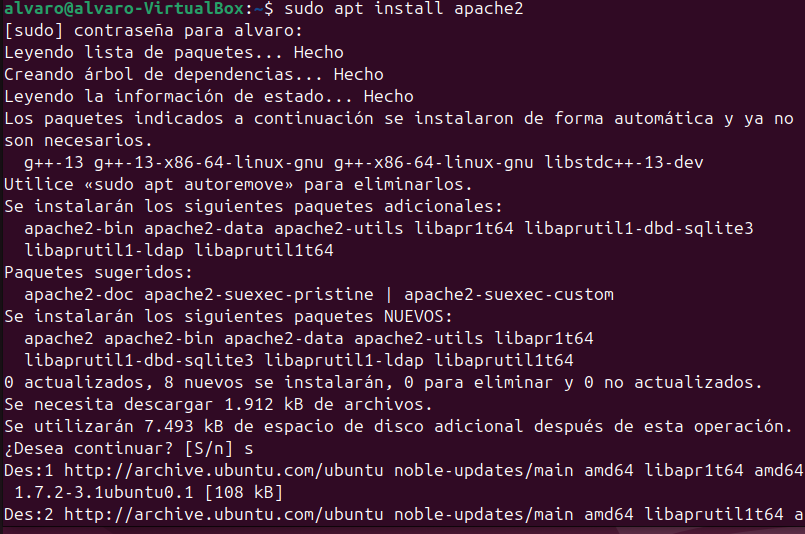
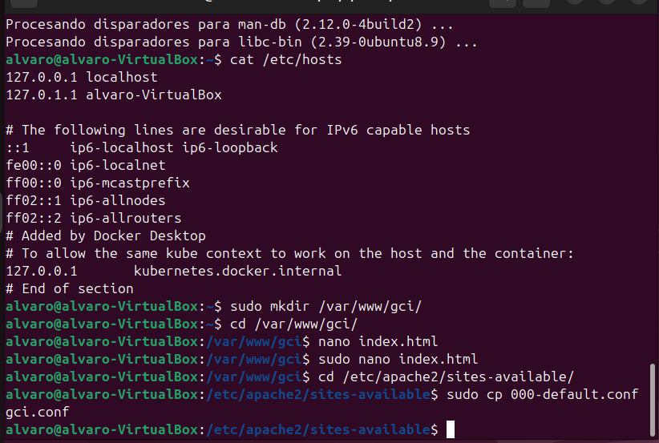
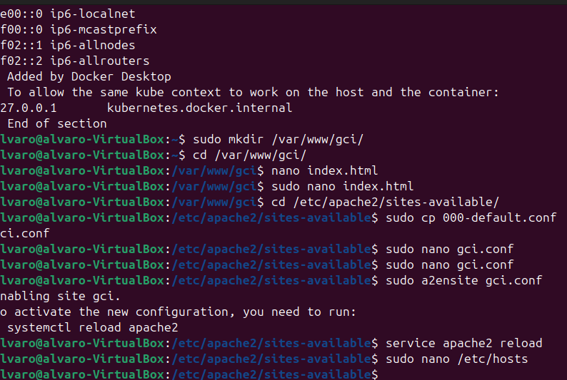
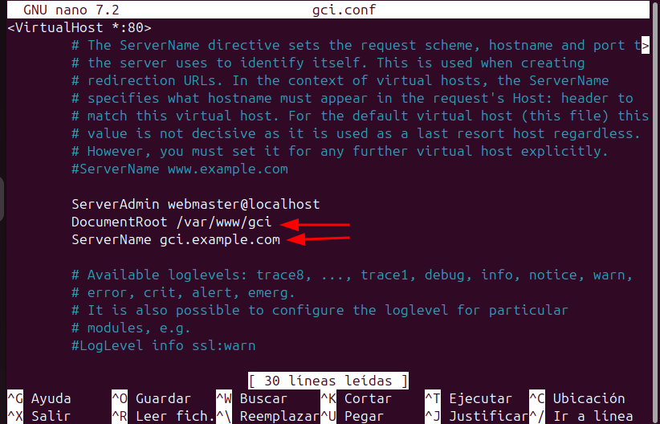
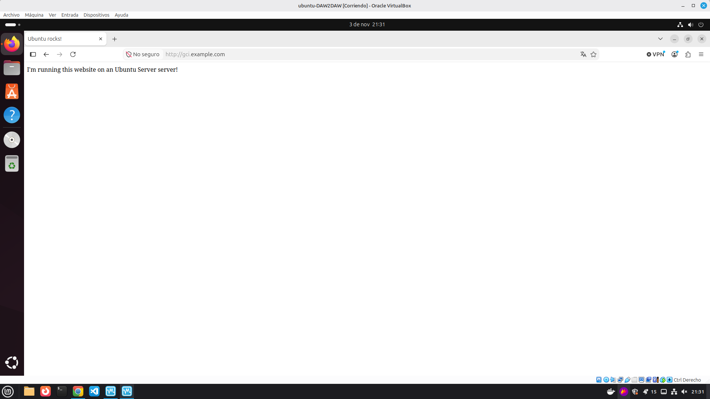

# Memoria técnica: Instalación y configuración de un servidor web Apache en Ubuntu

**Módulo:** Despliegue de Aplicaciones Web · 2º DAW
**Fecha:** 3 de noviembre de 2026

---

## Resumen

En este trabajo se documenta la instalación y la configuración básica del servidor web Apache sobre una máquina virtual con Ubuntu 24.04 en VirtualBox. Se instala el paquete `apache2`, se crea una página web sencilla y se configura un sitio virtual (*VirtualHost*) con su propio directorio raíz y nombre de dominio. Después se activa el sitio y se asocia el dominio a la máquina local mediante el archivo `/etc/hosts`. Por último, se comprueba desde el navegador que el sitio responde correctamente. El documento recoge el proceso paso a paso con capturas, los problemas encontrados, el banco de pruebas empleado, los resultados obtenidos y una valoración final.

## Índice

1. [Introducción](#1-introducción)
2. [Relación de actividades realizadas](#2-relación-de-actividades-realizadas)
3. [Presentación y valoración de resultados](#3-presentación-y-valoración-de-resultados)
4. [Conclusión](#4-conclusión)
5. [Bibliografía](#5-bibliografía)

---

## 1. Introducción

### 1.1 Contexto

El entorno es una máquina virtual con **Ubuntu 24.04 LTS** ejecutándose en **VirtualBox**, utilizada como equipo de pruebas para instalar y configurar servicios de red.

### 1.2 El entorno: Apache

**Apache HTTP Server** es un servidor web de código abierto que atiende peticiones HTTP/HTTPS y entrega al navegador las páginas y los recursos de un sitio web. Es multiplataforma y se amplía mediante módulos (por ejemplo, para HTTPS, reescritura de URL o control de acceso).

Su desarrollo comenzó en 1995, a partir del servidor NCSA HTTPd, y desde 1999 lo mantiene la **Apache Software Foundation**. Durante muchos años ha sido uno de los servidores web más utilizados del mundo.

### 1.3 Alternativas

| Servidor | Descripción breve |
|---|---|
| **Nginx** | Servidor web y proxy inverso, muy ligero y eficiente con muchas conexiones simultáneas. |
| **Microsoft IIS** | Servidor web de Microsoft, integrado en Windows Server. |

### 1.4 Motivación

El objetivo es aprender a poner en marcha un servidor web real: instalarlo, publicar una página propia y configurar un sitio virtual accesible por nombre de dominio. Esta tarea es la base para trabajos posteriores, como habilitar HTTPS o controlar el acceso a un sitio.

---

## 2. Relación de actividades realizadas

La configuración sigue los pasos 3, 4 y 5 del tutorial de Ubuntu *Install and configure Apache* (ver [bibliografía](#5-bibliografía)), precedidos por la instalación del servidor.

### 2.1 Instalación de Apache

Se instala el paquete `apache2` desde los repositorios de Ubuntu:

```bash
sudo apt install apache2
```



El sistema resuelve las dependencias, muestra los paquetes que se instalarán y pide confirmación (`s`).

### 2.2 Creación de la página web (paso 3 del tutorial)



utilizamos ```cat /etc/hosts``` para comprobar los hosts que tenemos actualmente.  
en los dos siguientes comandos creamos un nuevo directorio y metemos nuestro terminal en él, acto seguido crearemos un archivo index.html mediante sudo (ya que sin sudo no funciona).  
A continuación se accede a `sites-available` y se copia la configuración por defecto de Apache a un archivo nuevo, `gci.conf`.

### 2.3 Configuración y activación del sitio (pasos 4 y 5 del tutorial)



Se edita `gci.conf`, se activa el sitio con `a2ensite`, se recarga Apache y se abre `/etc/hosts` para asociar el dominio a la máquina local.

En el archivo `gci.conf` se modifican dos directivas: `DocumentRoot /var/www/gci` (carpeta con el contenido del sitio) y `ServerName gci.example.com` (nombre de dominio del sitio).



### 2.4 Comprobación del resultado

Al acceder desde el navegador a `http://gci.example.com`, se muestra el contenido de `index.html`, lo que confirma que el sitio virtual funciona:



### 2.5 Problemas surgidos

> No se dio ningun problema relacionado con la actividad pero si es recomendable poner 8 de ram a la maquiina virtual para que no vaya lenta

---

## 3. Presentación y valoración de resultados

### 3.1 Resultados obtenidos

Se ha instalado correctamente Apache en Ubuntu y se ha configurado un sitio virtual propio (`gci`) con su directorio raíz en `/var/www/gci` y el nombre de dominio `gci.example.com`. Tras activar el sitio y recargar el servicio, el navegador muestra la página creada, por lo que la configuración es correcta.

### 3.2 Valoración personal

> Gracias al tutorial proporcionado por el enlace en la bibliografia resulta una practica relativamente sencilla pero se deben de tener unos conocimientos minimos para poder realizarse, como el uso de bash, por lo demas resulta sencilla y rapida de realizar.

---

## 4. Conclusión

La actividad ha permitido instalar y configurar un servidor web Apache y publicar un sitio accesible por nombre de dominio, comprendiendo la función de los archivos de `sites-available`, del comando `a2ensite` y del archivo `/etc/hosts`. El resultado es un servidor funcional que sirve como base para configuraciones posteriores.

---

## 5. Bibliografía

- Ubuntu. *Install and configure Apache*. <https://ubuntu.com/tutorials/install-and-configure-apache#1-overview>