# Apache, certificados digitales, HTTPS

## ¿Qué es HTTPS?  
HTTPS es el protocolo seguro de HTTP; su función principal es cifrar tus datos.
Al escribir una URL o entrar a una web, tu navegador se comunica con el servidor a través del puerto 443, en lugar del puerto 80, y el servidor envía al
navegador su certificado oficial SSL/TLS. Este documento digital acredita que el sitio web es legítimo.
El navegador comprueba que el certificado sea válido, esté vigente y pertenezca al dominio al que intentas acceder.
El navegador usa dos tipos de cifrado:
- Cifrado asimétrico: Al inicio, se utiliza una clave pública y privada para acordar una clave compartida de forma segura.
- Cifrado simétrico: Una vez acordada esa clave única para la sesión, toda la transferencia de datos posterior se cifra y descifra con ella.  

## CERTIFICADOS SSL Y TLS  

• SSL (Secure Sockets Layer): Protocolo original de los años 90, actualmente obsoleto y se considera inseguro.
• TLS (Transport Layer Security): Es la versión moderna y más segura de SSL.  
La función principal de ambos es cifrar los datos; aunque SSL no se usa a día de hoy, sigue siendo mencionado como el protocolo de seguridad estándar.  

---

## Pasos a seguir para convertir un dominio a HTTPS  
Para esta práctica convertiremos el dominio de la práctica anterior en HTTPS.  
Como primer paso verificaremos que tengamos Apache instalado y operativo.  

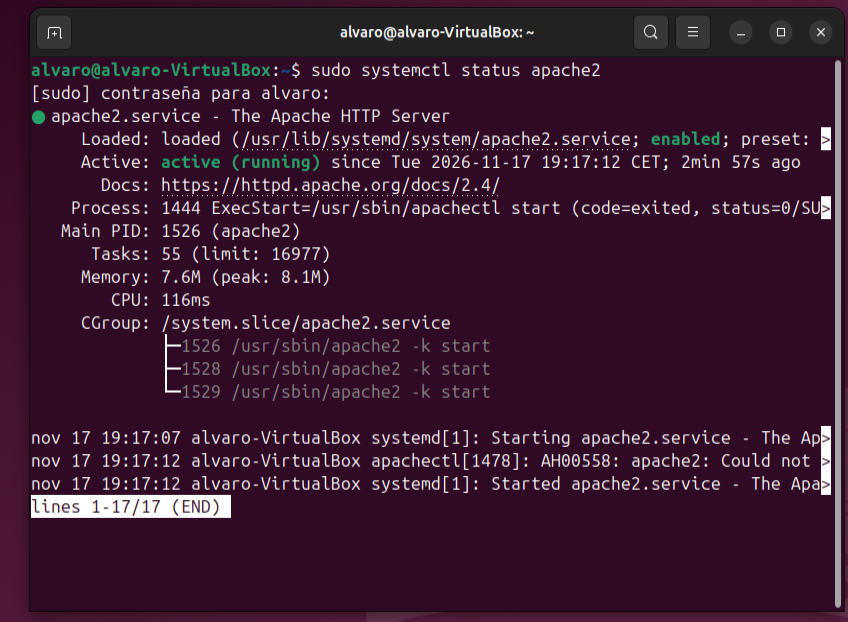  

Como se puede observar, está operativo.  

---

Lo siguiente que haremos es instalar SSL y los headers como se mostrará en la siguiente imagen:  

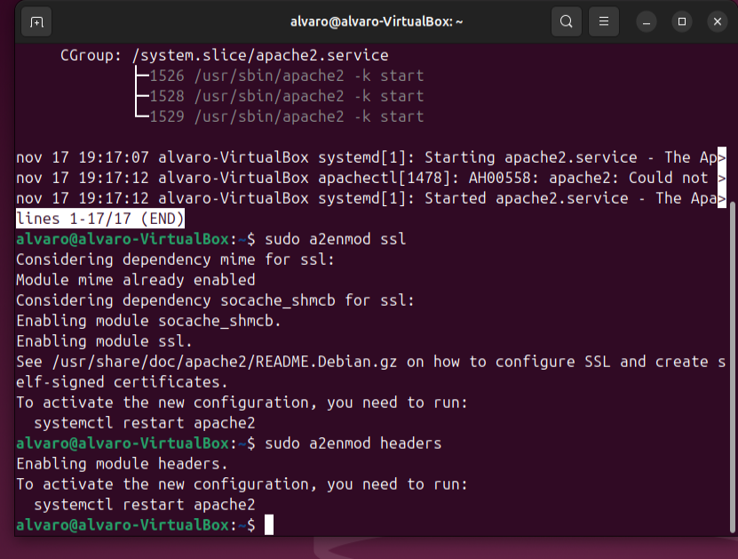

Tras esto reiniciaremos Apache y volveremos a comprobar que inicia correctamente:  

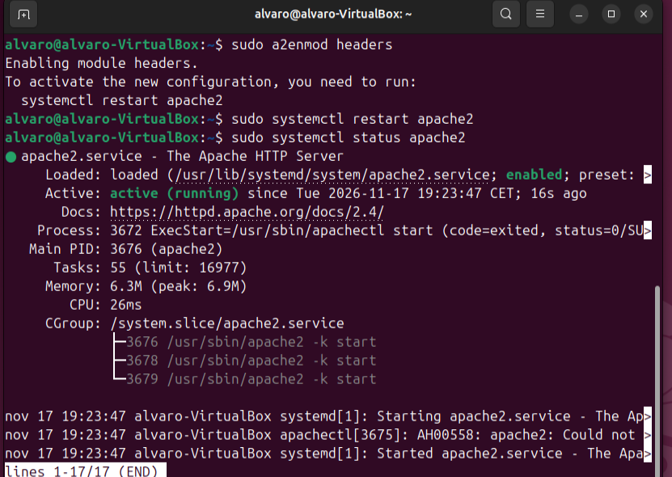  

---

A continuación usaremos este comando para generar un certificado local: `sudo openssl req -x509 -nodes -days 365 -newkey rsa:2048 -keyout /etc/ssl/private/apache-selfsigned.key -out /etc/ssl/certs/apache-selfsigned.crt`  

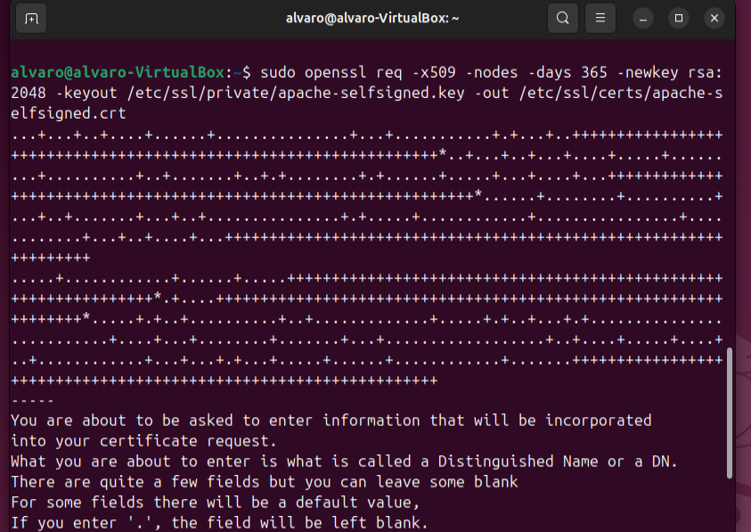  

También tendremos que responder algunas preguntas como se ve en la siguiente imagen:

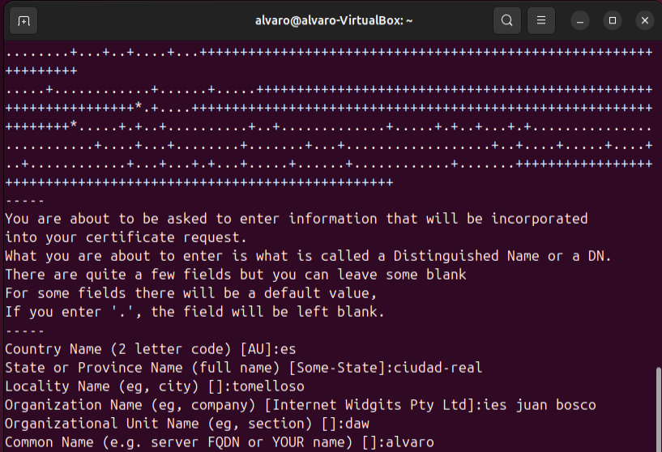

---

En el siguiente paso modificaremos el archivo default-ssl.conf como se muestra en la siguiente imagen:

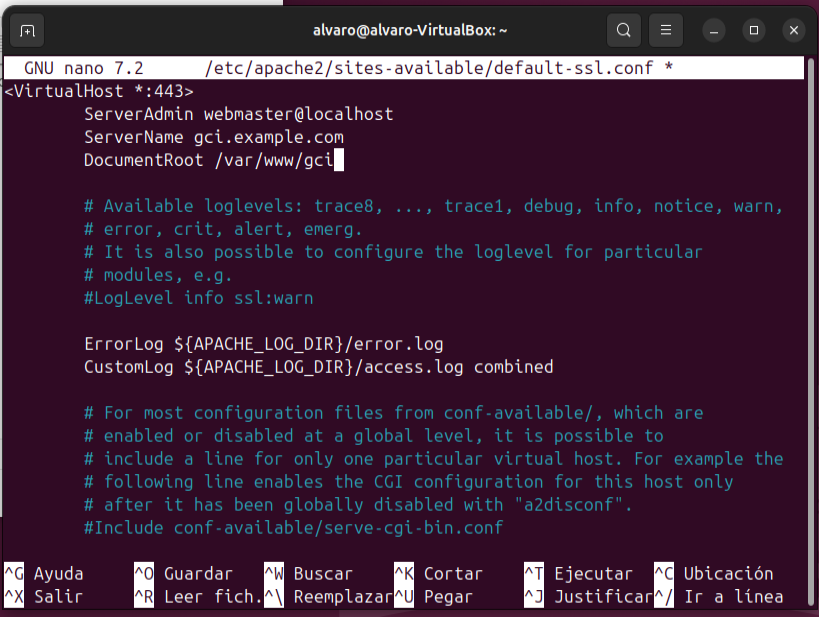

El cual hemos modificado con este comando:

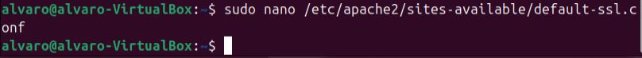

---

Ahora vamos a activarlo y verificar que la sintaxis del archivo sea correcta:

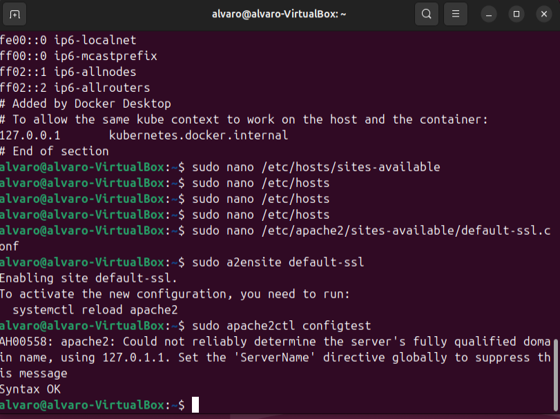

Tras este paso vamos a hacer muchas cosas seguidas:

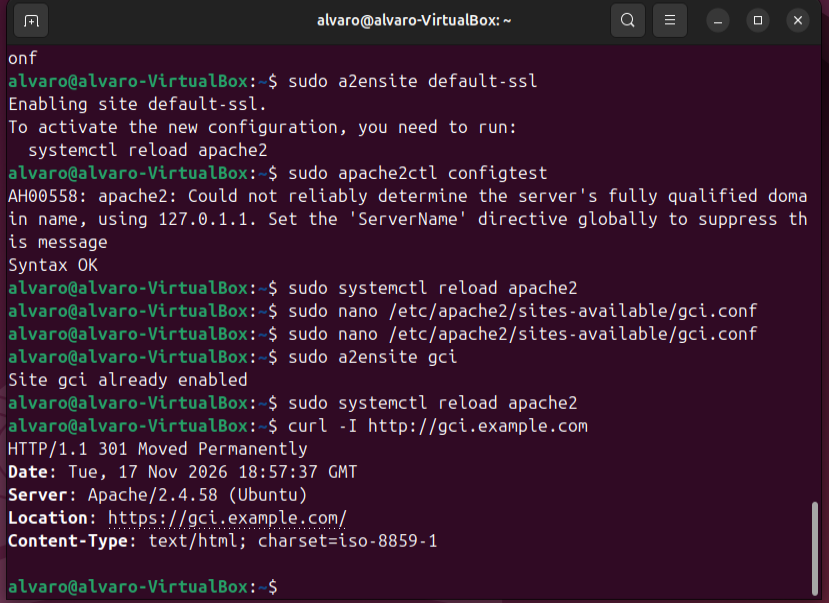

Lo primero que haremos será recargar Apache; tras eso modificaremos el archivo gci.conf como se mostrará en la imagen de más abajo. Después activaremos gci y usaremos el comando curl para que cuando lo intentemos abrir en el navegador se redireccione al HTTPS.

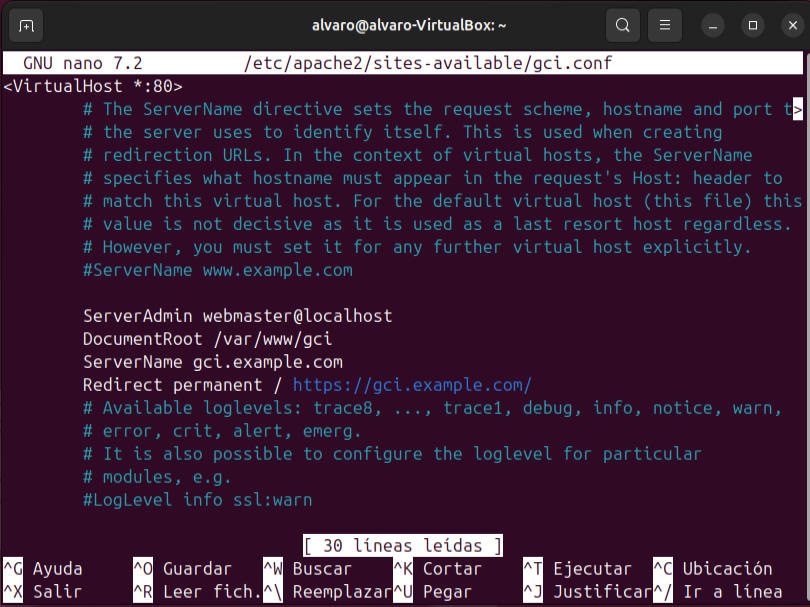

---

Por último comprobaremos que la página se abra correctamente en el navegador:

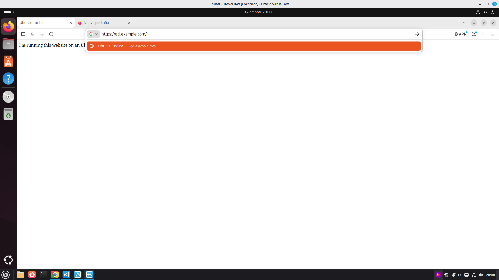

## Conclusión  

Esta práctica nos enseña el funcionamiento de los certificados digitales, así como a usar uno nosotros mismos, lo cual resulta útil de cara al despliegue de aplicaciones web grandes a futuro.